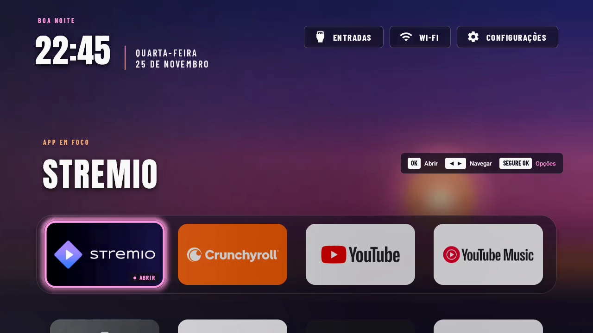

<div align="center">

# 🌅 Vice City Home

**Launcher leve para Android TV e Google TV, com visual neon de pôr do sol.**




<sub>Gravado na própria TV, em 1280×720. Os botões foram acionados pelo ADB.</sub>

[Instalação](#instalação) · [Instalar com uma IA](#instalar-com-uma-ia) · [Voltar ao original](#voltar-ao-original) · [Personalização](#personalização)

</div>

## Recursos

- **Seleção animada:** o cartão em foco cresce, acende em rosa e recebe um reflexo de luz.
- **Menu de opções:** segure **OK** num app para movê-lo, substituí-lo ou ver informações.
- **Atalhos no topo:** entradas (HDMI/AV), Wi-Fi e configurações.
- **Saudação com o seu nome:** o instalador pergunta durante a instalação. O APK não traz nome nenhum na saudação.
- **Leve:** sem anúncios, sem recomendações e sem permissão de internet.

## Compatibilidade

| Aparelho | Situação |
|---|---|
| TCL / SEMP, plataforma G13, Android 14, cerca de 1 GB de RAM | Launcher testado |
| Outros aparelhos com Android 8 ou superior | Não testados |
| Fire TV, Roku, Samsung (Tizen), LG (webOS) | Não suportados |

> O `install.ps1 -SetAsHome` foi testado com um ADB **simulado**. A troca que ele automatiza foi feita manualmente na TV acima; o script ainda não rodou numa TV real.

## Instalação

Você precisa de um PC com **Windows** na mesma rede da TV.

### 1. Prepare o PC

Instale o ADB e abra um **novo** terminal:

```powershell
winget install Google.PlatformTools
```

Baixe este repositório (**Code → Download ZIP**), extraia e abra o PowerShell **dentro da pasta**.

### 2. Prepare a TV

Os nomes dos menus variam entre fabricantes.

1. Em **Configurações → Sistema → Sobre**, pressione **OK sete vezes** sobre **Número da versão**.
2. Em **Opções do desenvolvedor**, ligue a **Depuração USB** e, se existir, a **Depuração de rede**.
3. Em **Configurações → Rede e internet**, anote o **IP** da TV.

### 3. Instale

Troque o IP:

```powershell
powershell -ExecutionPolicy Bypass -File .\install.ps1 -TvIp 192.168.1.50
```

O instalador pergunta **qual nome deve aparecer na TV**. Aperte **Enter** para ficar só com a saudação, como "Boa noite".

Aceite o aviso de depuração que aparece na TV. O launcher é instalado e aberto **como um app comum**: a tela inicial não muda. Teste com o controle.

> Para responder direto no comando, use `-Name "Alex"`. Se já baixou o APK da [release](../../releases/latest), acrescente `-Apk C:\caminho\vice-city-home.apk`.

### 4. Defina como tela inicial (opcional)

> [!WARNING]
> - A tela inicial do Google é **desativada** (não desinstalada). A tela de recuperação (`setupwraith`) também, se tentar ocupar o lugar do launcher.
> - **Redes Wi-Fi** criadas na configuração inicial da TV podem ser apagadas. Se for o caso da rede em uso, o instalador para e pede para esquecê-la e conectar de novo.
> - Funções do Google TV e **botões de atalho do controle** (como o do YouTube) podem deixar de funcionar.
> - No pior caso, se a TV não aceitar mais o ADB, pode ser preciso **restaurar de fábrica**.

```powershell
powershell -ExecutionPolicy Bypass -File .\install.ps1 -TvIp 192.168.1.50 -SetAsHome
```

Cada instalação reaplica o tema, então informe o mesmo nome quando ele perguntar.

O script verifica a TV, pede que você digite `SIM` e deixa um **desfazer automático** de 150 segundos, cancelado só quando a troca é confirmada.

### 5. Finalize

- [ ] O botão **Home** abre o launcher.
- [ ] **Entradas**, **Wi-Fi** e **Configurações** funcionam.
- [ ] A TV continua abrindo no launcher depois de **reiniciar**.
- [ ] A **depuração foi desligada** na TV.

## Instalar com uma IA

Se você usa um assistente de programação que roda comandos no seu PC, copie e cole:

```text
Instale o Vice City Home na minha Android TV.
Repositório: https://github.com/VictorGazarini/vice-city-tv-launcher
Antes de qualquer comando, leia o arquivo AGENTS.md do repositório e siga todas as regras dele.
```

O [AGENTS.md](AGENTS.md) traz o roteiro, as verificações e os pontos em que a IA **precisa parar e perguntar a você**. Confira o que ela pretende fazer antes de aprovar.

## Voltar ao original

Com a depuração ligada:

```powershell
powershell -ExecutionPolicy Bypass -File .\restore.ps1 -TvIp 192.168.1.50
```

Use `-Uninstall` para também remover o launcher.

> [!CAUTION]
> Não desinstale o launcher enquanto ele for a única tela inicial ativa. O `restore.ps1` confirma a restauração antes de remover.

## Personalização

Edite o [`theme/config.json`](theme/config.json) e rode a instalação de novo, **informando o mesmo nome**.

| Chave | Função |
|---|---|
| `dock_apps` | Apps da fileira principal, em ordem |
| `columns` | Apps por fileira |
| `dock_opacity` | Opacidade do painel, de 30 a 100 |
| `wallpaper_dim` | Escurecimento do fundo, de 0 a 90 |
| `wallpaper_true_color` | Cor completa no fundo; evita faixas e usa mais memória |

- **Pacotes instalados:** `adb shell pm list packages -3`
- **Fundo:** troque `theme/wallpaper.png` por uma imagem 1280×720. O original é gerado por [`tools/gen_wallpaper.py`](tools/gen_wallpaper.py).
- **Animação:** [`SelectionRing.java`](launcher/app/src/main/java/com/gathin/tvhome/SelectionRing.java) e [`SelectionGlow.java`](launcher/app/src/main/java/com/gathin/tvhome/SelectionGlow.java).

## Problemas comuns

| Problema | Solução |
|---|---|
| `unauthorized` ou sem conexão | Aceite o aviso na TV e confira o IP e a depuração de rede |
| `adb` não é reconhecido | Abra um novo terminal após instalar o Platform-Tools |
| O APK não baixa | Baixe pela página de releases e use `-Apk` |
| O instalador recusa a troca | Leia a mensagem: ele para quando não consegue garantir a segurança |
| A tela antiga voltou após uma atualização | Rode a instalação com `-SetAsHome` novamente |

<details>
<summary><b>Compilar a partir do código</b></summary>

<br>

Requisitos: JDK 17 e Android SDK (plataforma 34 e build-tools 34.0.0), com `ANDROID_HOME` definido.

```powershell
cd launcher
```

```powershell
.\gradlew.bat assembleRelease
```

O APK sai em `launcher/app/build/outputs/apk/release/app-release.apk`. Ele é assinado com a chave de depuração de quem compila: para atualizar uma instalação é preciso a mesma chave. Antes de desinstalar para trocar de chave, restaure a tela original.

</details>

<details>
<summary><b>Permissões</b></summary>

<br>

O app não declara a permissão de internet.

| Permissão declarada | Observação |
|---|---|
| `ACCESS_NETWORK_STATE`, `ACCESS_WIFI_STATE` | Estado da rede |
| `ACCESS_FINE_LOCATION` | O Android a exige para revelar o nome do Wi-Fi; o instalador não a concede |
| `WRITE_SECURE_SETTINGS` | Funções opcionais do projeto base; o instalador não a concede |
| `yandex.tv.permission.ACCESS_TV_SOURCE` | Herdada do projeto base |

Os serviços de acessibilidade e de notificações herdados do projeto base **não são ativados** pelo instalador.

</details>

## Créditos e licenças

Baseado no launcher do [Clean Your TV](https://github.com/Gathin23/cleanyourtv), de Gathin (MIT). Esta versão muda o visual, a animação de seleção e os menus, e traz instalador próprio.

[Licença MIT](LICENSE) · Fontes sob SIL OFL: [Anton](licenses/Anton-OFL.txt), [Barlow Condensed](licenses/BarlowCondensed-OFL.txt), [Outfit](licenses/Outfit-OFL.txt) · [Ícones Fluent Emoji](licenses/Fluent-Emoji-LICENSE.txt)

<sub>Projeto de fã, independente, sem afiliação ou endosso da Rockstar Games, Take-Two, Google, TCL, SEMP ou dos serviços exibidos. As marcas pertencem aos seus donos. Use por sua conta e risco.</sub>
